  

# Awesome LLM Token Optimization & Inference Efficiency ⚡🚀

  
  
  
  
  
  
  

> 🌟 **A comprehensive, SEO-optimized, production-ready curated index** of top LLM token optimization frameworks, prompt compression & pruning engines, high-efficiency GPU/CPU inference runtimes, speculative decoding systems, KV-cache reuse engines, and structured JSON output libraries. Featuring enterprise commercial SaaS platforms alongside community-driven open-source equivalents.

---

## 📖 Table of Contents

- [📊 Sector Overview & Market Dynamics](#-sector-overview--market-dynamics)
- [☁️ SaaS/Hosted Platforms](#️-saashosted-platforms)
- [💻 Open-Source Equivalents & Tools](#-open-source-equivalents--tools)
  - [✂️ Token Optimization, Prompt Compression & Pruning Engines](#️-token-optimization-prompt-compression--pruning-engines)
  - [🏎️ High-Throughput GPU LLM Inference & Serving Engines](#️-high-throughput-gpu-llm-inference--serving-engines)
  - [⏩ Speculative Decoding & Fast Token Generation Frameworks](#-speculative-decoding--fast-token-generation-frameworks)
  - [💾 KV-Cache Compression, Paging & Prefix Reuse Systems](#-kv-cache-compression-paging--prefix-reuse-systems)
  - [🎯 Constrained Decoding & Zero-Overhead Structured Output](#-constrained-decoding--zero-overhead-structured-output)
- [📈 Star History](#-star-history)
- [🤝 Contributing](#-contributing)
- [💖 Support & Sponsorship](#-support--sponsorship)

---

## 📊 Sector Overview & Market Dynamics

The global AI inference market is estimated at approximately **$106 billion in 2025** and is projected to expand toward **$254+ billion by 2030** (CAGR ~19%), driven by surging generative AI adoption and agentic multi-step reasoning workloads. The market displays a distinct bifurcation: the foundational hardware and accelerator silicon layer is **highly concentrated** (dominated by NVIDIA and select cloud hyperscalers), whereas the inference serving, prompt optimization, runtime caching, and gateway software layer is **moderately to highly fragmented** with intense competition among specialized ASIC clouds, serverless runtimes, and open-source engines.

---

## ☁️ SaaS/Hosted Platforms

Commercial, cloud-hosted ultra-fast inference clouds, specialized LPU/WSE/RDU hardware endpoints, and managed high-efficiency LLM serving APIs. Sorted descending by company scale (valuation / market capitalization).

| Platform | Company Valuation / Scale | Starting Pricing | Free Tier / Trial Limits | Description |
| :--- | :--- | :--- | :--- | :--- |
| **[NVIDIA NIM (TensorRT-LLM Cloud)](https://nvidia.com)** | ~$3,600 Billion (Public Market Cap) | Pay-as-you-go cloud compute: ~$1.00/GPU-hour (or $4,500/GPU/yr NVIDIA AI Enterprise software license) | 1,000 free API credits upon developer account creation for evaluation & prototyping (up to 90-day evaluation trial) | Enterprise managed microservices packaging TensorRT-LLM with FP8/INT4 quantization and in-flight batching. |
| **[DeepSeek API & DeepSeek-V3 Engine](https://deepseek.com)** | ~$86 Billion – $91 Billion (Reported Valuation) | $0.15/1M input tokens ($0.003/1M cached input), $0.60/1M output tokens (Off-peak, Flash tier) | No standing free tier; periodic transient promotional sign-up balances for new developers | Commercial API powered by Multi-Head Latent Attention (MLA), FP8 training/inference, and automatic disk context caching. |
| **[Cerebras Inference Cloud](https://cerebras.ai)** | ~$23 Billion (Valuation) | Pay-as-you-go developer API starting at $0.10/1M input & $0.10/1M output tokens (Llama 3.1 8B) | $5 promotional credit (valid for 30 days) upon adding payment method; capped at ~30 RPM & 60,000–150,000 TPM | Wafer-Scale Engine (WSE) cloud platform eliminating off-chip memory bandwidth bottlenecks for massive token generation throughput. |
| **[Fireworks AI (Fast Inference)](https://fireworks.ai)** | ~$17.5 Billion (Valuation) | Serverless pay-per-token starting at $0.05/1M input tokens (cached input ~50% off) & $0.20/1M output tokens | $1.00 one-time starter trial credit upon account registration | High-speed serverless and dedicated inference cloud utilizing custom CUDA kernels, multi-LoRA packing, and prompt caching. |
| **[Baseten](https://baseten.co)** | ~$13 Billion (Valuation) | Scale-to-zero dedicated GPUs billed per-minute: NVIDIA T4 at ~$0.0105/min (~$0.63/hr), NVIDIA L4 at ~$0.0141/min (~$0.85/hr) | $30 one-time free developer trial credit upon workspace creation | Commercial model serving infrastructure providing autoscaling GPU clusters, cold-start optimization, and TensorRT-LLM runtimes. |
| **[SambaNova Cloud](https://sambanova.ai)** | ~$11 Billion (Valuation) | Pay-as-you-go developer tier starting at $0.22/1M input & $0.59/1M output tokens (gpt-oss-120b) | Free forever plan: 20 Requests Per Minute (RPM), 20 Requests Per Day (RPD), and 200,000 Tokens Per Day (TPD) | Enterprise AI inference cloud running on Reconfigurable Dataflow Units (RDUs) optimized for high-efficiency, long-context model serving. |
| **[Together Turbo (Together AI)](https://together.ai)** | ~$8.3 Billion (Valuation) | Serverless pay-as-you-go starting at $0.06/1M input & $0.18/1M output tokens ($15 min initial prepaid credit) | No perpetual free plan or trial credits; $15 minimum prepaid credit required to activate API access | Managed cloud inference engine combining FlashAttention-3, FP8 quantization, and speculative decoding for rapid token throughput. |
| **[GroqCloud (Groq LPU)](https://groq.com)** | ~$3.5 Billion (Valuation) | On-demand pay-as-you-go starting at $0.075/1M input & $0.30/1M output tokens (GPT-OSS 20B) | Free forever plan: 30 Requests Per Minute (RPM), 8,000–30,000 Tokens Per Minute (TPM), and up to 500,000 Tokens Per Day (TPD) | Deterministic Language Processing Unit (LPU) cloud inference platform delivering hundreds of tokens per second with ultra-low time-to-first-token. |
| **[Portkey](https://portkey.ai)** | ~$150 Million (Acquired by Palo Alto Networks) | Developer plan is $0/mo; Production / Pro plan starts at $49/mo (includes 100,000 logs/reqs; $9 per addl 100k logs) | Free forever Developer plan: 10,000 requests/logs per month, 3-day log retention | Enterprise AI gateway offering semantic caching, fallback routing, and token budget governance across LLM providers. |
| **[FriendliAI](https://friendli.ai)** | ~$100 Million – $250 Million (Estimated Valuation) | Serverless endpoints starting at $0.10/1M tokens; Dedicated GPU instances starting at ~$2.90/hr (A100 80GB) | Free serverless Tier 0 developer access with dynamic rate limits & promotional starter testing credits | Managed high-efficiency LLM serving cloud featuring iteration-level continuous batching and adaptive GPU scheduling. |

---

## 💻 Open-Source Equivalents & Tools

Free and open-source software (FOSS) token optimizers, prompt compressors, PagedAttention/RadixAttention serving engines, speculative decoders, and KV-cache compressors. All tools are tagged with real-time Stars_Badges linking to their stargazers page and ranked by star popularity.

### ✂️ Token Optimization, Prompt Compression & Pruning Engines

* **[RAGFlow (InfiFlow)](https://github.com/infiniflow/ragflow)**  - Leading open-source engine combining deep document parsing with token-efficient hybrid retrieval and prompt pruning.
* **[DSPy (Stanford NLP)](https://github.com/stanfordnlp/dspy)**  - Declarative open-source framework that algorithmically compiles concise, token-efficient prompts and weights for smaller models.
* **[FreeToken (flashml-org)](https://github.com/flashml-org/FreeToken)**  - Open-source token optimization and inference efficiency toolkit engineered to maximize token throughput and minimize redundant token overhead.
* **[LLMLingua & LongLLMLingua (Microsoft)](https://github.com/microsoft/LLMLingua)**  - Industry-leading open-source prompt compression framework achieving up to 20x token reduction for RAG, CoT, and long-context prompts.
* **[Selective Context](https://github.com/liyucheng09/Selective_Context)**  - Open-source utility pruning redundant lexical units in prompts based on self-information to accelerate prefill and reduce token count.

### 🏎️ High-Throughput GPU LLM Inference & Serving Engines

* **[Ollama](https://github.com/ollama/ollama)**  - Get up and running with large language models locally with optimized quantization, dynamic batching, and cross-platform acceleration.
* **[llama.cpp](https://github.com/ggerganov/llama.cpp)**  - Foundational open-source C/C++ inference engine enabling high-efficiency quantized execution across CPUs, NVIDIA/AMD GPUs, and Apple Metal.
* **[vLLM (PagedAttention)](https://github.com/vllm-project/vllm)**  - The industry-standard open-source high-throughput LLM serving engine maximizing GPU utilization via PagedAttention and continuous batching.
* **[DeepSpeed-FastGen (Microsoft)](https://github.com/microsoft/DeepSpeed)**  - High-performance inference engine leveraging Dynamic SplitFuse attention to maximize throughput while minimizing latency and token overhead.
* **[SGLang](https://github.com/sgl-project/sglang)**  - Blazingly fast open-source serving runtime featuring RadixAttention automatic prefix caching and zero-overhead CPU scheduling.
* **[TensorRT-LLM (NVIDIA)](https://github.com/NVIDIA/TensorRT-LLM)**  - Open-source C++/CUDA library compiling LLMs into optimized TensorRT engines with FP8/INT4 quantization, in-flight batching, and tensor parallelism.
* **[Triton Inference Server (NVIDIA)](https://github.com/triton-inference-server/server)**  - Enterprise open-source multi-model inference serving software optimized for GPU/CPU pipeline execution with dynamic batching.
* **[Text Generation Inference (TGI - Hugging Face)](https://github.com/huggingface/text-generation-inference)**  - Production-grade open-source Rust and Python serving toolkit with continuous batching, FlashAttention, and tensor parallelism.
* **[BitsAndBytes](https://github.com/TimDettmers/bitsandbytes)**  - Accessible 4-bit and 8-bit quantization primitives and CUDA kernels drastically cutting VRAM requirements for high-efficiency LLM inference.
* **[LMDeploy (InternLM)](https://github.com/InternLM/lmdeploy)**  - High-efficiency open-source toolkit powered by the C++/CUDA TurboMind engine supporting persistent batching and online KV quantization.
* **[AutoGPTQ](https://github.com/AutoGPTQ/AutoGPTQ)**  - Easy-to-use LLM quantization package based on 4-bit GPTQ with post-training quantization kernels for high-speed token generation.
* **[ExLlamaV2](https://github.com/turboderp/exllamav2)**  - Fast inference library for local LLM deployment featuring optimized EXL2 multi-bit quantization and ultra-low VRAM memory footprint.
* **[AutoAWQ](https://github.com/casper-hansen/AutoAWQ)**  - Activation-aware Weight Quantization (AWQ) engine delivering 2x–3x faster inference speeds with minimal perplexity degradation.
* **[Aphrodite Engine](https://github.com/PygmalionAI/aphrodite-engine)**  - High-throughput open-source inference engine combining PagedAttention with extensive low-bit quantization formats (EXL2, AWQ, GPTQ, FP8).

### ⏩ Speculative Decoding & Fast Token Generation Frameworks

* **[Medusa](https://github.com/FasterDecoding/Medusa)**  - Open-source framework adding extra decoding heads to LLMs to predict multiple tokens per step without needing a separate draft model.
* **[EAGLE / EAGLE-2 / EAGLE-3](https://github.com/SafeAILab/EAGLE)**  - State-of-the-art open-source speculative decoding framework accelerating LLM generation by 3x–5x via feature-level auto-regression.
* **[Lookahead Decoding](https://github.com/hao-ai-lab/LookaheadDecoding)**  - Exact, lossless open-source parallel decoding algorithm accelerating LLM inference without draft models or data stores.
* **[SpecForge (SGLang)](https://github.com/sgl-project/SpecForge)**  - Open-source training and serving toolkit for building custom speculative decoding draft models tailored for high-throughput production.

### 💾 KV-Cache Compression, Paging & Prefix Reuse Systems

* **[FlashAttention (Tri Dao)](https://github.com/Dao-AILab/flash-attention)**  - IO-aware exact attention CUDA kernels maximizing Tensor Core and HBM efficiency on modern GPUs.
* **[LMCache](https://github.com/LMCache/LMCache)**  - Open-source KV-cache storage and reuse engine sharing precomputed prompt KV states across GPU, CPU DRAM, and disk to slash prefill compute.
* **[StreamingLLM (MIT HAN Lab)](https://github.com/mit-han-lab/streaming-llm)**  - Efficient framework enabling LLMs trained with finite length to process infinite input token sequences without fine-tuning.
* **[Mooncake (Moonshot AI)](https://github.com/kvcache-ai/Mooncake)**  - KVCache-centric disaggregated open-source serving architecture pooling distributed DRAM and SSD resources for high-efficiency inference.
* **[FlashInfer](https://github.com/flashinfer-ai/flashinfer)**  - High-performance open-source kernel library providing customized paged attention, cascade attention, and compressed KV-cache kernels.
* **[H2O (Heavy-Hitter Oracle)](https://github.com/FMInference/H2O)**  - Open-source KV-cache eviction policy retaining critical heavy-hitter tokens to reduce memory bandwidth bottlenecks.
* **[KIVI](https://github.com/jy-yuan/KIVI)**  - Tuning-free asymmetric 2-bit KV-cache quantization framework slashing memory footprint and boosting batch size throughput.

### 🎯 Constrained Decoding & Zero-Overhead Structured Output

* **[Guidance](https://github.com/guidance-ai/guidance)**  - Open-source constrained generation framework interleaving control logic and token fast-forwarding for efficient structured outputs.
* **[Outlines](https://github.com/dottxt-ai/outlines)**  - Open-source structured text generation library using finite-state machines to guarantee valid schemas without wasted retry tokens.
* **[XGrammar (MLC)](https://github.com/mlc-ai/xgrammar)**  - High-speed open-source structured generation engine achieving near-zero overhead token masking for JSON and regex schemas.
* **[LLGuidance (Microsoft)](https://github.com/microsoft/llguidance)**  - Ultra-fast Rust-based context-free grammar (CFG) and JSON schema constraint engine with token fast-forwarding to skip boilerplate tokens.

---

## 📈 Star History

---

## 🤝 Contributing

Contributions are always welcome! Feel free to open a Pull Request to add more open-source LLM token optimization tools, prompt compressors, high-efficiency inference engines, or speculative decoding frameworks. 🛠️

1. 🍴 Fork the repository.
2. 🌿 Create your feature branch (`git checkout -b feature/awesome-tool`).
3. 📝 Add your project under the appropriate category with a concise description and correct GitHub link.
4. 🚀 Submit a Pull Request.

---

## 💖 Support & Sponsorship

Thank you so much for exploring and using **Awesome-LLM-Token-Optimization-Inference-Efficiency**! 🙏

If you find this repository valuable for your AI projects, research, or engineering workflows, please consider supporting its ongoing curation and maintenance:

- ⭐ **Star this repository** to help others discover it on GitHub!
- 🍴 **Fork and share** it with your engineering team, AI research groups, and tech communities.
- ☕ **Buy me a coffee & sponsor my work**: You can directly sponsor ongoing open-source curation on the [GitHub Sponsor Dashboard](https://github.com/sponsors/ishandutta2007). Your support helps keep this curated guide continuously up to date!
